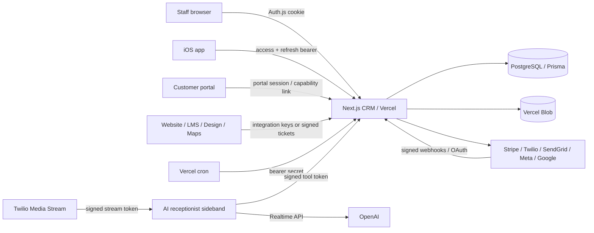

# CRM Security Assessment — 2026-10-14

## Executive brief

This source-assisted assessment covered the Next.js CRM, its 551 API route modules, the Storm CRM iOS client, the AI receptionist sideband, Prisma/PostgreSQL deployment path, blob handling, and the code-facing boundaries to Stripe, Twilio/SendGrid, OpenAI, Google, Meta, APNs, LMS, Maps, Design, and company websites.

The review confirmed two release-blocking design flaws in the original code: a session-update path accepted client-supplied role and tenant claims, and several trusted callback/job paths could authenticate successfully when their shared secret was absent. Both are remediated in this change set and have regression tests. Distributed abuse controls, environment-wide outbound safety, browser headers, upload signature checks, iOS storage protection, AI-sideband limits, route inventory, and CI security gates were also implemented.

This is not a penetration-test attestation. No deployed synthetic staging tenant, provider test accounts, Vercel configuration, production database configuration, or Apple runtime was available in the repository. Those controls remain **unverified** until the staging runbook is executed and evidence is attached. Release approval should therefore require the staging and provider checks listed in the retest report.

## Scope and baseline

- Web and API: OWASP ASVS 5.0 Level 2 and OWASP API Security Top 10 2023.
- iOS: OWASP MASVS/MASTG, with source review on Windows and runtime tests deferred to macOS/Xcode.
- Payments: PCI DSS v4.x data-flow and responsibility boundary review only; no certification claim.
- Excluded: production exploitation, social engineering, phishing, physical testing, stress/denial-of-service testing, and testing third-party infrastructure without authorization.

## Architecture summary

Trust boundaries, assets, threats, and abuse cases are expanded in `THREAT-MODEL.md`. The machine-generated API classification is in `route-security-manifest.csv` and `route-security-manifest.json`.

## Findings and disposition

| ID | Severity | Status | Finding and evidence | Required follow-up |
|---|---:|---|---|---|
| CRM-SEC-001 | Critical | Remediated in code | The Auth.js JWT callback accepted client-provided `id`, `companyId`, `role`, and `trueRole` during `session.update()`, enabling controlled privilege/tenant claim injection. The callback now accepts only typed actions, reloads authoritative users from PostgreSQL, verifies linked accounts, and versions JWTs to revoke legacy tokens. | Execute the two-tenant role/session tests in staging; verify legacy sessions are signed out once. |
| CRM-SEC-002 | High | Remediated in code | Cron, Twilio, SendGrid inbound, and Meta callback paths could fail open when secrets/configuration were missing. Shared cron verification and callback-specific guards now return 503 for missing configuration and reject invalid credentials/signatures. | Test every callback with absent, empty, invalid, stale, replayed, and valid credentials. |
| CRM-SEC-003 | High | Remediated in code | Staff/mobile login, MFA, reset, portal login-link, and integration-key abuse controls were absent or process-local. PostgreSQL-backed atomic buckets now key on hashed identity, source address, credential, and operation, fail closed if storage is unavailable, and are pruned by an authenticated daily maintenance job. | Load-test thresholds and lockout recovery in synthetic staging; connect operational alerting. |
| CRM-SEC-004 | High | Remediated in code; operational validation pending | Application-level communication freeze could be bypassed by authentication/diagnostic flows. A provider-adjacent environment gate now blocks all low-level SMS, voice, and email sends unless the recipient is allowlisted in staging. | Configure provider test resources and egress interception, then reconcile canaries and logs. |
| CRM-SEC-005 | High | Partially remediated | Inbox and inbound-email paths enforce count, size, type, and magic-byte checks; the shared private-blob boundary now invokes a fail-closed HTTPS malware scanner for every blob upload when required mode is enabled; blob responses use `nosniff`, safe disposition, and sandbox CSP. A scanner provider must still be connected, and uniform file-signature/archive handling across every upload type remains incomplete. | Configure `MALWARE_SCAN_MODE=required` with a private scanner, then test malicious/oversize/archive payloads and finish uniform type/signature policies. |
| CRM-SEC-006 | Medium | Remediated in code | Baseline browser headers were incomplete. CSP, HSTS, frame denial, MIME protection, referrer policy, permissions policy, COOP, and origin isolation headers are now configured and unit tested. | Browser-test CRM, Stripe, Google OAuth, Twilio Voice, maps, and blob previews; tighten CSP from compatibility sources to nonces/hashes. |
| CRM-SEC-007 | High | Partially remediated | Production build used `prisma db push --accept-data-loss`. Destructive acceptance was removed, security tables/columns have idempotent additive rollout code, and the same DDL is preserved as a reviewed security migration artifact. The repository still lacks a baselined Prisma migration history and proven rollback/restore procedure. | Baseline the live schema with database access, adopt `prisma migrate deploy`, and attach backup/PITR plus timed restore evidence before schema-changing release. |
| CRM-SEC-008 | Medium | Remediated in source; runtime unverified | iOS tokens and cached identity did not have an explicit device-only accessibility policy, and offline store protection was implicit. Tokens/profile now use `AfterFirstUnlockThisDeviceOnly`; offline files use complete-until-first-authentication protection; a security test target was added. | Run tests on macOS, inspect device files, validate screenshots, push payloads, deep links, background location, and lost-device revocation. |
| CRM-SEC-009 | Medium | Remediated in code | The AI sideband could allocate expensive upstream work before adequate resource controls and logged full provider errors. It now limits global/per-IP connections, start time, message size/rate, bad JSON, and duration, disables compression, and logs reduced error metadata. | Exercise valid/invalid Twilio streams, tool authorization, prompt injection, tenant isolation, and cost ceilings in staging. |
| CRM-SEC-010 | Medium | Remediated in code | Google OAuth state now contains a random nonce, is HMAC-bound to tenant and provider, expires after 15 minutes, and is atomically consumed once from PostgreSQL. | Exercise replay, cross-provider substitution, expiry, cancellation, and concurrent callbacks in staging. |
| CRM-SEC-011 | Medium | Substantially remediated | Marketing open/click links now use HMAC-signed 90-day tokens bound to recipient, purpose, and—on clicks—the exact safe destination. Tampering, purpose swapping, destination changes, and expiry have regression tests. | Decide whether repeated legitimate clicks should count individually; add edge rate limiting if provider traffic shows abuse. |
| CRM-SEC-012 | High | Partially remediated | Invoice/estimate links now use 256-bit random tokens, enforce a 180-day expiry and revocation on every unauthenticated lookup, auto-rotate before customer sends, and expose authenticated rotate/revoke endpoints with staff audit records. Existing links receive expiry during rollout. Tokens remain retrievable in plaintext in PostgreSQL for resend compatibility. | Decide between encrypted-at-rest retrievability and a signed derived-token redesign; validate expired/revoked/concurrent rotation in staging. |
| CRM-SEC-013 | Medium | Open | Static inventory found 536 routes without an obvious audit-event marker and 541 without a route-local rate-limit marker. These are triage signals, not proof that every route needs those controls. | Add declarative route policies and structured audit events to all sensitive mutations/reads; review the 125 high-priority routes first. |
| CRM-SEC-014 | Medium | Remediated in code | The seed script created known demo passwords and could be invoked in production. It now generates a random password unless explicitly supplied and refuses production by default. | Keep seed variables out of production and ensure demo accounts cannot reach production. |
| CRM-SEC-015 | High | Unverified | Vercel access, preview exposure, database roles/TLS/PITR, vendor IAM/scopes, retention, and provider-side security settings cannot be established from source alone. | Collect the evidence checklist in `PROCESS-CONTROLS.md`; treat missing evidence as a release risk. |
| CRM-SEC-016 | Medium | Remediated in code; runtime unverified | Middleware now applies one Origin and Fetch-Metadata policy to cookie-authenticated API mutations while explicitly excluding bearer, OAuth/provider, cron, public, and integration endpoints that have their own authentication. Unit tests cover cross-site denial, same-origin access, and exemptions. | Browser/proxy-test cross-site JSON, form, and multipart requests and confirm every exemption has independent authentication. |
| CRM-SEC-017 | High | Substantially remediated in code | User/configuration-controlled server fetches could reach arbitrary URLs, and some flows forwarded provider credentials. A shared outbound-fetch policy now requires HTTPS, rejects credentials and private/loopback/link-local DNS results, revalidates redirects, strips credentials cross-origin, enforces exact provider hosts where appropriate, and bounds downloaded files. It protects LMS certificates/sync, website hiring, sitemap/indexability checks, external blobs, Twilio media, and Housecall Pro downloads. | Exercise DNS rebinding, redirects, IPv4/IPv6 edge cases, and required external hosts from deployed infrastructure; inventory any future server fetch through the shared policy. |

## Route inventory

The deterministic inventory covers all **551** route modules: **403** contain mutating methods and **126** are automatically prioritized for manual review. Authentication classifications include 410 staff/mobile routes, 33 portal-session routes, 24 Twilio-signature routes, 16 integration-key routes, 9 cron routes, and smaller OAuth, Stripe, AI, public-capability, and recovery surfaces. The generated classification is a review aid; it does not prove authorization correctness.

Acceptance requires a human owner to confirm audience, role, tenant predicate, object ownership, rate limit, side effects, and audit need for each row. CI fails when source changes make the committed manifest stale.

## Verification completed locally

- TypeScript typecheck: passed.
- Application unit suite: passed (357 tests, including new security regressions).
- API manifest freshness check: passed (551 routes; digest recorded in JSON).
- AI receptionist sideband TypeScript build: passed.
- ESLint: passed with zero errors and 13 warnings; warnings are recorded as cleanup work.
- Dependency audit: cached/offline metadata reported no known production vulnerabilities; this is not authoritative. CI runs an online `npm audit --omit=dev --audit-level=high`.
- iOS build/runtime tests: not run because this host is Windows.
- Active ZAP/manual proxy/provider/staging tests: not run because a designated synthetic deployment and test credentials were not supplied.

## Release decision

The confirmed Critical and callback-authentication High defects are fixed in source, but release should remain conditional on: (1) synthetic two-tenant authorization testing, (2) provider callback replay/signature tests, (3) CSP/browser compatibility testing, (4) iOS device validation, (5) public-link plaintext-storage redesign or time-bound risk acceptance, and (6) operational evidence for database recovery, Vercel access, secrets, malware scanning, and test communications containment.
